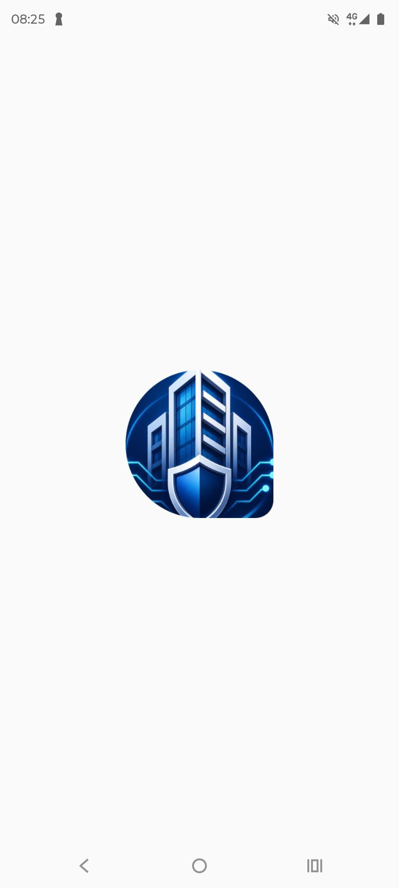
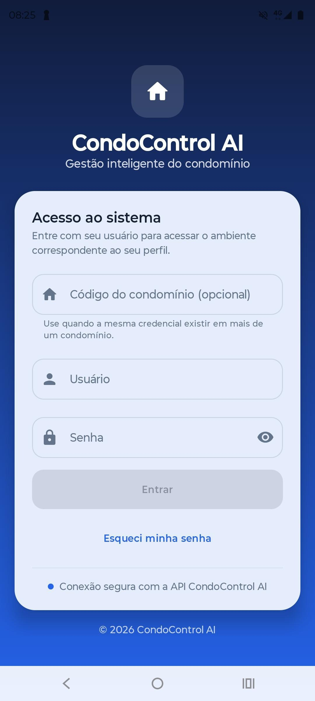
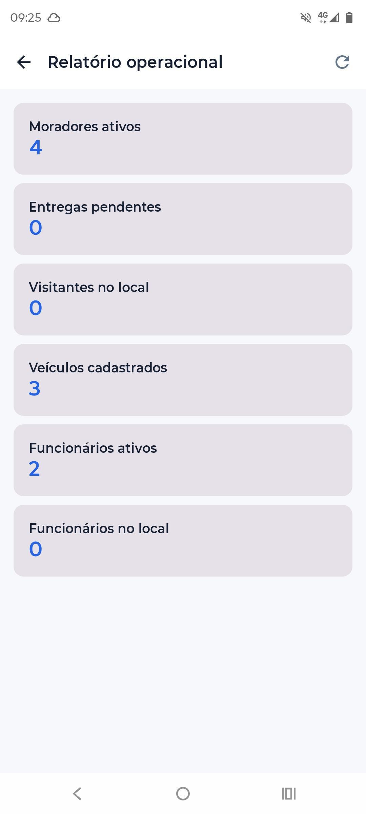

# 🏢 CondoControlAI

### Plataforma de Gestão Condominial | Android • Web • Backend • Inteligência Artificial

O **CondoControlAI** é um projeto de software para modernizar a gestão de condomínios, integrando aplicativo Android, painel administrativo web, portal do morador e API REST.

> 🔒 Este repositório é uma apresentação técnica do projeto. O código-fonte original é privado.

## 🎯 Objetivo

Centralizar processos operacionais e administrativos de condomínios, com foco em rastreabilidade, segurança, comunicação e eficiência.

## 🚀 Funcionalidades do projeto

- 📦 Cadastro e acompanhamento de encomendas
- 📸 Registro fotográfico e leitura de etiquetas
- 🤖 Processamento de etiquetas com inteligência artificial e revisão humana
- 📱 Aplicativo Android para operações de portaria
- 👥 Cadastro de moradores, funcionários e visitantes
- 🚗 Gestão de veículos
- 🔐 Autenticação e permissões por perfil
- 🏢 Estrutura multi-condomínio
- 📊 Painel administrativo com indicadores
- 📝 Histórico de operações e auditoria
- 📅 Reservas de áreas comuns
- 🔔 Notificações e comunicação com moradores
- 🔎 Consulta e pesquisa de registros

## 🛠️ Tecnologias

| Camada | Tecnologias |
| --- | --- |
| Android | Kotlin, Jetpack Compose, Room, Hilt, Retrofit |
| Backend | PHP, API REST |
| Banco de dados | MySQL |
| Web | HTML, CSS, JavaScript |
| Segurança | JWT, controle de permissões e isolamento por condomínio |
| Inteligência artificial | Integração com serviços de IA e OCR |
| Ferramentas | Android Studio, VS Code, Git e GitHub |

## 🏗️ Arquitetura geral

```text
         Aplicativo Android
                 |
          API REST (PHP)
                 |
             MySQL
                 |
      Painéis e portais web
```

O aplicativo Android e os painéis web se comunicam com a API REST, que centraliza as regras de negócio e o acesso aos dados. A representação acima é simplificada e não inclui componentes internos de segurança.

## 🔐 Segurança e privacidade

O projeto contempla mecanismos de autenticação, autorização por perfil, separação lógica de dados por condomínio, rastreabilidade e políticas de retenção.

**Observação:** esta documentação não constitui uma certificação de segurança ou conformidade com a LGPD. Os controles exigem validação no ambiente de implantação.

## 🧪 Qualidade e validação

O desenvolvimento inclui atividades de testes funcionais, testes de API, validação de regras de negócio e análise de registros técnicos.


## 📷 Demonstrações do aplicativo

Confira algumas interfaces do CondoControlAI.

<p align="center">
  
  
  
</p>

<p align="center"><strong>Abertura | Login | Relatório operacional</strong></p>

> Capturas demonstrativas. Informações pessoais devem ser removidas antes da publicação.
  
  

## 👨‍💻 Desenvolvimento

Projeto desenvolvido por **Thiago Almeida Teles**, envolvendo análise de requisitos, modelagem de dados, desenvolvimento Android, backend, interfaces web, integrações e testes.

## 📬 Contato

- [Perfil no GitHub](https://github.com/thiagofoztt-creator)
- [LinkedIn](https://www.linkedin.com/in/thiago-de-almeida-teles-9924a13a5)

---

**Código-fonte proprietário e privado.** Este repositório destina-se exclusivamente à apresentação do projeto.
  
